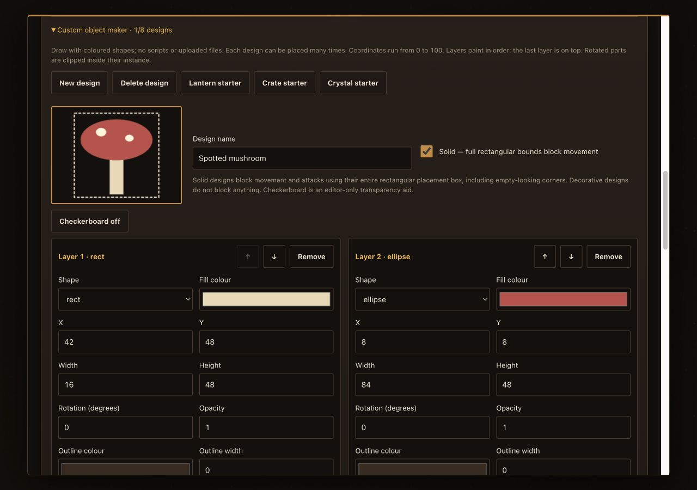
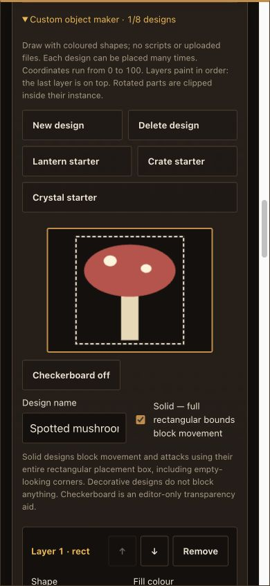
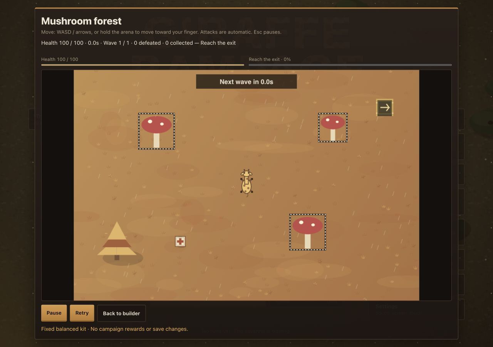

# Challenge Workshop prototype

Local branch: `codex/challenge-builder`. Nothing is published by this feature.

1. Main-menu workshop and an always-available Guide topic.
2. Recipe editor: title, creator, opening message and reproducible seed.
3. Eleven templates, including decorated Dusk garden, Meteor yard, Rainy courier, Snow lanterns, Mushroom forest and Desert signal station.
4. Wave director: up to 12 waves, four groups each, directions, delays, duplication and reordering; 240 enemies per level.
5. Snap-grid arena builder: walls, hazards, coins, exit, healing pickups and decorative trees, rocks and banners; selection, moving, resizing, duplication, coordinate placement, erase/remove, undo/redo (60 edits), 48-object limit. Three layout recipes and an editor-only grid toggle.
6. Clear, survive, collect and escape objectives; three fixed kits, seven biomes, enemy speed/health and player speed/attack-rate modifiers, plus darkness. Cosmetic day/sunset/night, clear/drizzle/snow and scenery detail settings.
7. Independent autoattack arena runtime: four enemy archetypes, keyboard and hold-to-move pointer controls, collision, health, pause, retry and results.
8. Versioned, checksummed Unicode-safe code/link sharing; import/remix without automatic execution.
9. Exact-recipe local-clear sharing gate. Editing revokes it; imported completion is never trusted. Not online anti-cheat verification.
10. Separate browser-local 24-recipe draft shelf; no campaign rewards, save changes or cloud synchronization.
11. Import limits and clearance-aware reachability validation for collectibles/exits.
12. Data/runtime unit suites and integrated browser regression scenario.
13. Shared deterministic editor/playtest arena painter: textured terrain, shadows, detailed props, weather and improved creature silhouettes. A scene preview never consumes the combat random stream.
14. Authoritative kit-stat preview, objective hints, enemy role descriptions, rough composition budget and three quick-wave presets (Swarm, Ambush, Brute finale). Budget is not a measured difficulty rating.
15. Seven arena biomes: savanna, arctic, moon, forest, desert, swamp and volcanic. Biome, autumn, pastel, dusk and custom palettes affect the arena, not the original game's brown/gold interface.
16. Custom ground/accent/foliage colors and a layered custom-object designer. Up to eight reusable named designs with twelve rectangle/ellipse/triangle layers each; layers have their own dimensions, position, rotation and color. Definitions travel with the level code.
17. Custom objects are decorative by default. An optional solid setting blocks movement and attacks with the object's **entire rectangular bounds**, regardless of painted transparent space. The same bounds are used for spawn and reachability validation. Custom definitions contain validated shape data only, never scripts or remote assets.
18. Shape fill opacity and outline color/width; duplicate, center and horizontal-mirror actions, transparency checkerboard, and Lantern/Crate/Crystal starter designs. Mirroring/centering edits shape geometry; the checkerboard is editor-only and does not revoke a local clear.
19. Live recipe validation with specific errors, palette swatches and biome-color copying, selected-object semantics, authoritative enemy stats, per-wave summaries, and export code length/readiness.
20. More detailed biome terrain and prop materials, health/objective bars, wave/countdown banners, capped fading damage/pickup labels, and results with healing/health/wave totals. Presentation does not consume combat randomness or change balance.

## Verification and screenshots

The final local data/runtime suites pass **61 + 31 tests**. The integrated DOM scenario passes at **1280×900**, **390×844**, and **844×390**, with no captured JavaScript errors. These are browser viewport checks, not physical-device/touch-emulation certification. Package construction, script-list synchronization, README recount and whitespace checks pass. Full local CI cannot launch its Playwright browser because its executable is not installed; this is not a green full-CI claim.

This is deliberately simplified standalone combat and code-drawn art, not a level editor for the full campaign gear/card/enemy systems. No online discovery, accounts, leaderboards, multiplayer, or hosted short-code service is included. Sharing links use the current page URL, so localhost links are only portable after replacing the origin with the deployed game URL. Codes can be pasted independently of hosting.

Draft storage is separate from the campaign bridge. Back it up through a cleared recipe code before clearing browser storage. Local clear records are session-local; reopening a draft requires another clear. Validation conservatively rejects narrow passages but cannot establish combat beatability.

## Tests

`node tools/challenge-data-test.mjs` — recipe/codec/library validation.

`node tools/challenge-play-test.mjs` — fixed-step combat, objectives, input, pauses, collision, cleanup and save isolation.

`node tools/qa-cloud.mjs tools/scenarios/challenge-builder.js --wait 30000 --shot workshop.png` — integrated DOM scenario. Repeat at `--w 390 --h 844 --touch` and `--w 844 --h 390 --touch`.

`node tools/qa-preview.mjs` — browser-visible full-game harness at the printed localhost URL when a headless browser is unavailable. This is a testing server only, not a website build.

Before publishing, run `bash tools/ci-check.sh`, the challenge scenario and phone touch checks, then verify the packaged game. Publishing remains subject to owner review.
